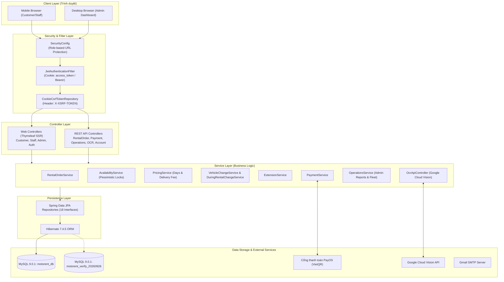

# 01 - TỔNG QUAN DỰ ÁN MOTORENT (PROJECT OVERVIEW)

## 1. Mục Đích & Bối Cảnh Dự Án (Project Purpose & Context)
- **Tên dự án:** MotoRent Đà Nẵng (`motorbike-rental`)
- **Mục tiêu:** Hệ thống quản lý và cho thuê xe máy tự phục vụ và giao nhận tại Đà Nẵng, phục vụ khách du lịch và người dân địa phương.
- **Bản chất nghiệp vụ:** 
  - Phục vụ kinh doanh thực tế một cửa hàng duy nhất (Single Store) tại 11 Nguyễn Văn Tạo, P. An Khê, Q. Thanh Khê, TP. Đà Nẵng.
  - Hỗ trợ 3 nhóm đối tượng người dùng: Khách thuê xe (`CUSTOMER`), Nhân viên điều hành/giao nhận (`STAFF`), và Chủ kinh doanh/Quản trị viên (`ADMIN`).
  - Tích hợp thanh toán trực tuyến PayOS, định giá động theo số ngày thuê và khoảng cách giao nhận xe (Haversine formula), quản lý cọc tài sản (tiền mặt / bảo lãnh CCCD), hỗ trợ đổi xe (trước và trong khi thuê), gia hạn hợp đồng, trả xe sớm và đối soát tài chính theo dòng tiền.

---

## 2. Công Nghệ Thực Tế (Verified Tech Stack)
Dựa trên source code và runtime được kiểm định thực tế:

| Thành phần | Công nghệ thực tế | Ghi chú & Đánh giá |
|---|---|---|
| **Ngôn ngữ** | Java 21 (Oracle JDK 21.0.7 LTS) | `pom.xml` khai báo `source=17`, nhưng biên dịch và chạy bằng JDK 21 |
| **Framework Backend** | Spring Boot 4.1.1 (Spring Framework 7.0.9) | Kiến trúc Monolith, Spring MVC + Data JPA + Security |
| **Build Tool** | Apache Maven 3.9.8 | Độc lập hoặc qua IntelliJ plugin, hỗ trợ các profiles/POM verification |
| **Cơ sở dữ liệu** | MySQL 9.0.1 (Community Server) | Production schema: `motorent_db`; Testing/Clone schema: `motorent_verify_20260926` |
| **In-Memory DB** | H2 Database 2.4.240 | Dùng cho Unit / Mock Tests khi không bật cờ MySQL |
| **Bảo mật & Auth** | Spring Security + JJWT 0.11.5 + BCrypt | Stateless JWT (HttpOnly cookie `access_token` & Bearer header) + Rotating Cookie CSRF (`XSRF-TOKEN`) |
| **Template Engine** | Thymeleaf 3 + Layout Fragments | Server-Side Rendering (SSR) kết hợp REST API |
| **Frontend Styling** | Tailwind CSS (CDN) + Vanilla CSS | `operations.css` (31.5KB), `staff.css` (10.7KB), `customer-workspace.css` (5.6KB) |
| **Frontend Logic** | Vanilla JavaScript (ES6+) | Không sử dụng React/Vue/Angular; code tổ chức dạng module script |
| **Cổng thanh toán** | PayOS Java SDK v1.0.3 | Thanh toán QR Code ngân hàng (VietQR), webhook chữ ký HMAC SHA-256 |
| **Bản đồ & Tọa độ** | Leaflet.js + OpenStreetMap | Tính khoảng cách giao xe bằng công thức Haversine |
| **OCR / Trí tuệ nhân tạo** | Google Cloud Vision API (REST) | Regex parser CCCD Việt Nam; Spring AI Starter OpenAI có trong POM nhưng disable |
| **Email** | Spring Boot Mail (JavaMail) | Cấu hình SMTP Gmail |
| **WebSockets** | Spring WebSocket Starter | Khai báo trong POM |

---

## 3. Kiến Trúc Hệ Thống (System Architecture)

### 3.1. Sơ đồ kiến trúc tổng thể (Mermaid Diagram)



### 3.2. Luồng xử lý dữ liệu chuẩn (Standard Data Flow)
```
Request -> SecurityFilterChain (JWT Filter -> CSRF Filter)
        -> Controller (Auth validation via CurrentUser)
        -> Service (Transaction boundary + Pessimistic Locking on Bikes/Orders)
        -> Repository (Spring Data JPA)
        -> Database (MySQL with READ_COMMITTED / REPEATABLE_READ)
        -> Response DTO / Thymeleaf Model
```

---

## 4. Cấu Trúc Thư Mục Dự Án (Directory Structure)

```
d:/Motorbike-rental
├── .phase*-verification-pom.xml      # Các file POM đóng gói kiểm thử từng giai đoạn
├── .verification-pom.xml             # POM cho bản build verified
├── AGENTS.md                         # Quy chuẩn kỹ thuật và nguyên tắc phát triển
├── BUSINESS_RULES.md (in docs)       # Quy tắc nghiệp vụ chi tiết
├── PROJECT_CONTEXT.md                # Hiện trạng và lưu ý hệ thống
├── Start-MotoRent.ps1                # Script khởi chạy ứng dụng (Port 8080 / 8082 -Verify)
├── pom.xml                           # File cấu hình Maven chính
├── docs/                             # Tài liệu kỹ thuật, kế hoạch, logs qua các phase
│   ├── audit/                        # Thư mục chứa 12 báo cáo Audit toàn diện (Handoff)
│   ├── gemini-handoff/               # Tài liệu bàn giao & Business acceptance cases (65 cases)
│   ├── phase1-20260928/ -> phase9/   # Chi tiết nghiệm thu từ Phase 1 đến Phase 9
├── src/
│   ├── main/
│   │   ├── java/com/motorrent/motorbikerental/
│   │   │   ├── config/               # Cấu hình Security, PayOS, Upload, Thymeleaf, Seeders
│   │   │   ├── controller/
│   │   │   │   ├── api/              # 13 REST API Controllers (Orders, Payment, Operations, OCR...)
│   │   │   │   └── web/              # 7 Web Page Controllers (Customer, Staff, Admin, Auth...)
│   │   │   ├── dto/                  # Request & Response Data Transfer Objects
│   │   │   ├── entity/               # 18 JPA Entities (RentalOrder, Motorbike, Payment, User...)
│   │   │   ├── enums/                # Enums: RentalStatus, MotorbikeStatus, UserRole
│   │   │   ├── exception/            # Global Exception Handling & Error Codes
│   │   │   ├── mapper/               # MapStruct Mappers (UserMapper, RentalOrderMapper...)
│   │   │   ├── repository/           # 18 Spring Data JPA Repository Interfaces
│   │   │   ├── security/             # CustomUserDetails, CurrentUser, JwtUtil, JwtAuthFilter
│   │   │   └── service/              # 20 Service classes xử lý nghiệp vụ lõi
│   │   └── resources/
│   │       ├── application.properties # Cấu hình ứng dụng chính
│   │       ├── static/               # File tĩnh: css/, js/, images/
│   │       └── templates/            # Thymeleaf HTML Templates (customer, staff, admin, auth)
│   └── test/java/com/motorrent/motorbikerental/ # 15 Test classes (Unit, Integration, Concurrency)
├── target/                           # Build outputs & verified JARs
└── uploads/                          # Thư mục lưu trữ ảnh người dùng tải lên
```

---

## 5. Các Tích Hợp Bên Ngoài (External Integrations)
1. **PayOS (Cổng thanh toán QR Code ngân hàng):**
   - Tạo link thanh toán động: Đặt cọc (`BOOKING`), Bổ sung đổi xe (`VEHICLE_CHANGE`), Gia hạn hợp đồng (`EXTENSION`).
   - Webhook xác nhận giao dịch tự động với chữ ký số SHA-256.
   - Endpoint đối soát chủ động (`/api/payment/reconcile/{id}`) khi webhook đến muộn hoặc mạng chập chờn.
2. **Google Cloud Vision (OCR căn cước công dân):**
   - API `/api/ocr/cccd` nhận ảnh căn cước công dân, gửi tới Google Vision REST API để trích xuất số CCCD, họ tên, ngày sinh, địa chỉ.
3. **OpenStreetMap / Leaflet:**
   - Hiển thị bản đồ chọn vị trí giao nhận xe và cửa hàng tại Đà Nẵng.
4. **Gmail SMTP:**
   - Gửi mã xác thực OTP quên mật khẩu và thông báo giao dịch.

---

## 6. Hướng Dẫn Vận Hành & Khởi Chạy (How to Run)

### 6.1. Môi trường yêu cầu (Prerequisites)
- JDK 21 hoặc JDK 17 (đã kiểm định tốt nhất trên Java 21).
- Maven 3.9+ (hoặc Maven tích hợp trong IDE như IntelliJ IDEA).
- MySQL 9.0+ đang chạy trên cổng 3306 với hai cơ sở dữ liệu `motorent_db` và `motorent_verify_20260926`.

### 6.2. Các lệnh khởi chạy chuẩn
- **Chạy môi trường chính (Port 8080):**
  ```powershell
  .\Start-MotoRent.ps1
  ```
- **Chạy môi trường kiểm thử cách ly (Port 8082 trên database clone):**
  ```powershell
  .\Start-MotoRent.ps1 -Verify
  ```
- **Biên dịch và chạy 122 automated tests:**
  ```powershell
  & "C:\Program Files\JetBrains\IntelliJ IDEA Community Edition 2024.2.4\plugins\maven\lib\maven3\bin\mvn.cmd" test -f .phase9-verification-pom.xml
  ```
- **Chạy 20 bài test concurrency trực tiếp trên MySQL:**
  ```powershell
  & "C:\Program Files\JetBrains\IntelliJ IDEA Community Edition 2024.2.4\plugins\maven\lib\maven3\bin\mvn.cmd" test -f .phase9-verification-pom.xml "-Dtest=Phase1ConcurrencyTests" "-Dphase1.mysql=true"
  ```
